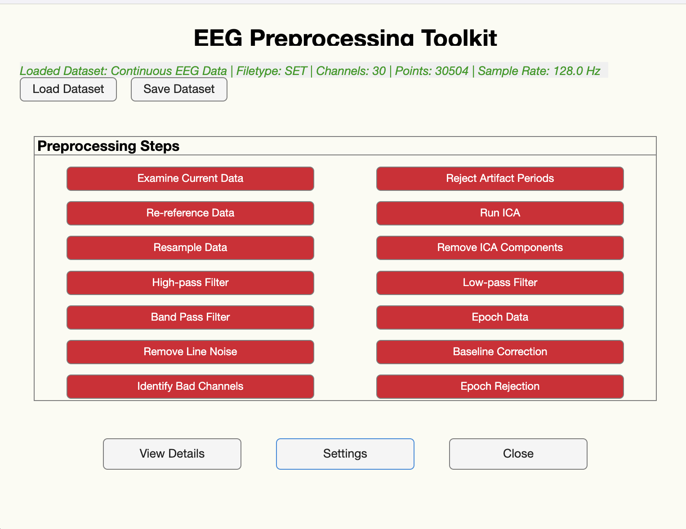

EEGToolkit is a MATLAB-based data preprocessing toolkit that provides a streamlined preprocessing pipeline for EEG data within the EEGLAB environment. It integrates widely used EEGLAB plugins and automates common preprocessing steps such as filtering, artifact removal, and IC classification.

Source code: <a href="https://github.com/EEGToolkit/DataPreprocessing_Analysis"><i class="large github icon "></i>EEGLab Toolkit</a>
